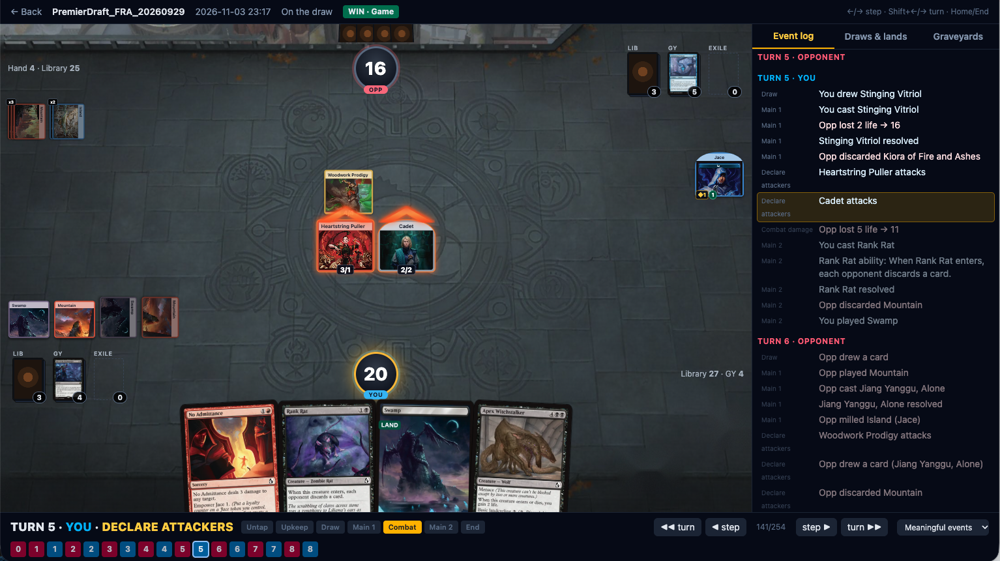

# Arena Replay Viewer

Local web app that replays MTG Arena games from 17Lands logs as a readable board: card images, turn/phase tracker, draw and land stats. See [spec.md](spec.md) for the original design.



## How to run it

You need a free [17Lands](https://www.17lands.com) account that has your Arena games uploaded (via the 17Lands client).

**1. Install Node.js** (one time): download the "LTS" version from https://nodejs.org and install it. Version 20 or newer.

**2. Download this project:** click the green **Code** button on GitHub → **Download ZIP**, then unzip it. (Or `git clone` it if you know how.)

**3. Get your 17Lands token:** go to https://www.17lands.com/account, turn on **"Visible on public pages"**, and copy the long 32-character code from your shareable link. Use that one, **not** the "Client token" box. The token stays on your computer; it's only used to fetch your own games from 17Lands.

**4. Save the token:** in the project folder, make a copy of `.env.example` and name it `.env` (the file is hidden on some systems; any text editor can create it). Open it and paste the token after the `=`:

```
SEVENTEENLANDS_TOKEN=paste_your_token_here
```

**5. Start it:** open a terminal in the project folder (Mac: right-click the folder → *New Terminal at Folder*; Windows: click the folder's address bar, type `cmd`, press Enter) and run:

```sh
npm install      # first time only, takes a minute
npm run dev
```

**6. Open http://localhost:5173** in your browser. To stop, press `Ctrl+C` in the terminal. Next time, you only need step 5's `npm run dev`.

**Troubleshooting:** a "token is not set" error means `.env` is missing or misnamed. If 17Lands returns errors (403), wait a few minutes; it rate-limits, and the app retries on its own.

For developers: `make test` runs the tests, `npm run typecheck` checks types.

## Layout

| Path | What |
|---|---|
| `shared/` | `parseHistory()` (GRE log → `ReplayDTO`), stats (draw table, land drops, hypergeometric), shared types. Vitest tests in `shared/test`. |
| `server/` | Fastify API + SQLite cache (`cache/cache.sqlite`) + image cache (`cache/images`). 17Lands client (throttled), card/ability/deck ingestion. |
| `web/` | Vite + React + Tailwind 4 + Zustand. Pages: events → event detail (deck, games) → replay. |
| `fixtures/` | Saved raw 17Lands logs used by the parser tests. |

## Findings that differ from the spec

- **Token / endpoints.** `/data/history` needs no auth at all (just `Accept: application/json`). The game list is `GET /data/user_game_list/{token}` and events are `GET /user/data/{token}`; both want the *public share* token. The game list only holds the most recent 100 games.
- **No ZoneTransfer annotations.** 17Lands strips them, so the parser infers every move (draw, cast, mill, die…) by diffing zone membership per stable card id (`ObjectIdChanged` annotations are aliased). Mills/extra draws are attributed to the spell or ability on the stack.
- **Mulligans** appear as all old instances deleted + a fresh 7 dealt (not as hand→library moves). Only the kept hand counts as "seen".
- **Images:** the fallback chain is 17Lands `image_url` → Scryfall by Arena id → Scryfall by exact name. Scryfall has no `arena_id` for FRA cards yet, and 17Lands ships an image URL with every card, so it goes first. Images are cached forever on disk.
- **17Lands rate-limits bursts** (AWS WAF → HTTP 403 for a while). The server serializes all 17Lands calls with a 600 ms gap and falls back to cached lists. Game logs are fetched once and stored gzipped.
- **Import fallback:** the Events page has "Import log JSON" for a log saved by hand.

## Not done / ideas

- Bo3: logs for later games have not been seen yet; a game's history path is `date/hash` and `/n` in the link looks like the game index.
- "Prepare"/MDFC cards under a second grpId are not merged yet.
- Per-game review notes, starred cards, share-as-image.
